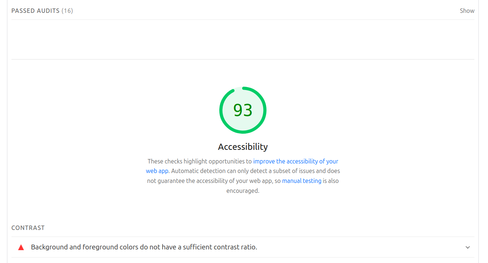
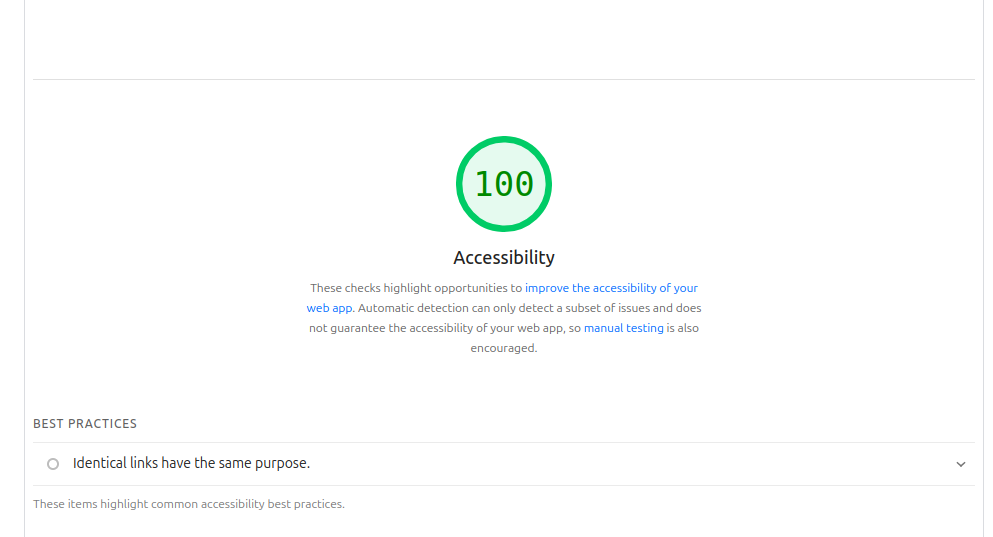

# Accessibility Audit

- Initial audit
    - I intially got a 93% due to contrast issues with my text and background color. 

- Fixes
    - I made the background darker andn increased the brightness of the text
    - These changed resulted in a 100% score.

- Summary
    - After making that small change I was able to achive a 100% accessibilty score

